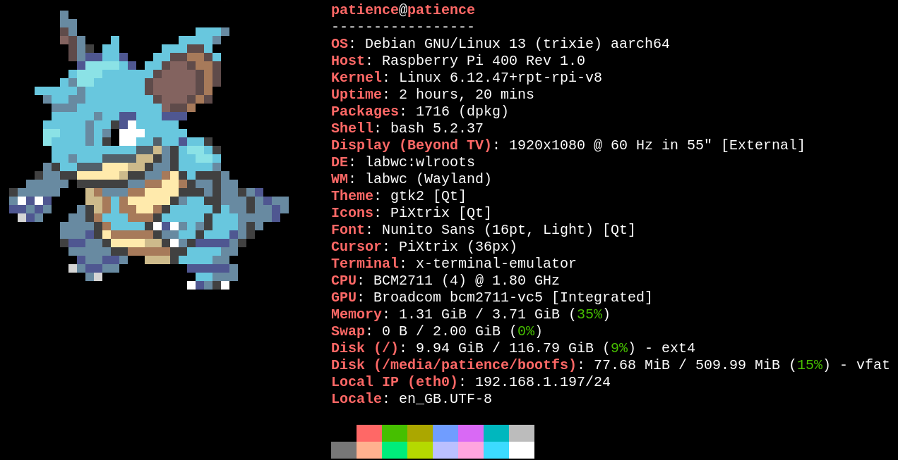

# fetch
Currently, I use __fastfetch__ for all computer-info-fetching, atleast for stylistic purposes.  
Used to use neofetch, and it still works well, but *fast*fetch is, well, *faster*. Also neofetch is not updated anymore.
>https://github.com/fastfetch-cli/fastfetch

Recently I've been using a combination of fastfetch and [pokeget](https://github.com/talwat/pokeget-rs) to display system information
on startup of my terminal. To do this on startup, I find .bashrc, and edit the file to say-  
```
pokeget random -- hide-name | fastfetch --file-raw -
```  
-at the ___very END___ of the .bashrc file, on its own line.

In the pokeget command, "_random_" can be replaced with any pokemon you desire. If I specify a pokemon, its usually Gengar.
___
### Here's what it looks like on my Raspberry Pi:

